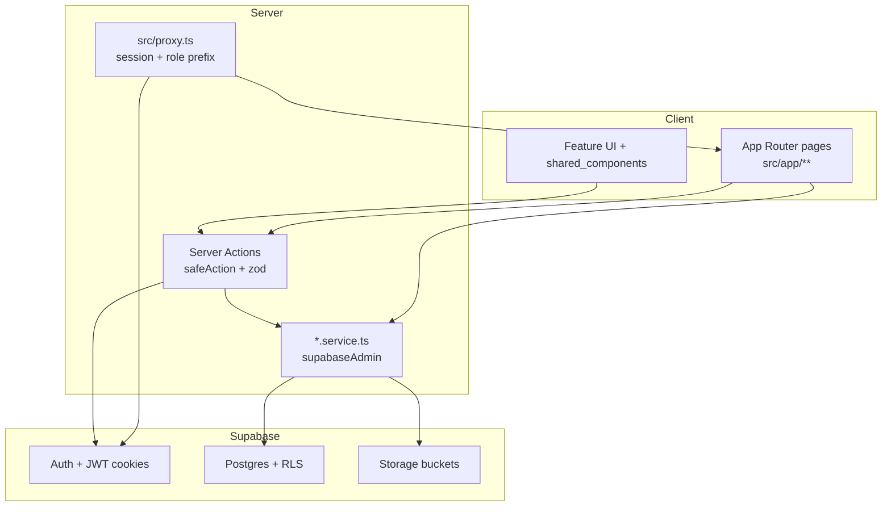
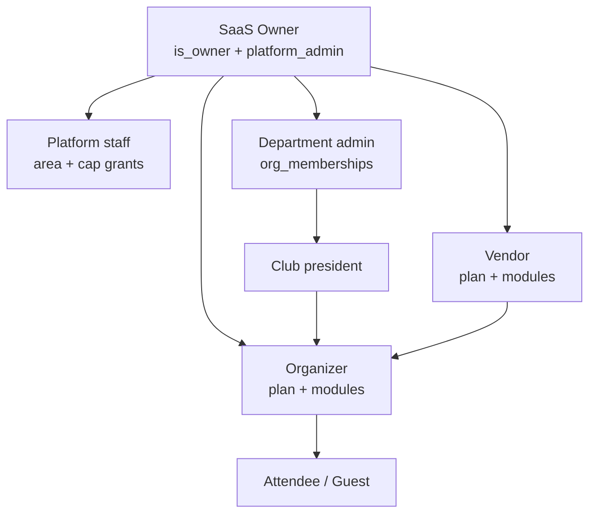
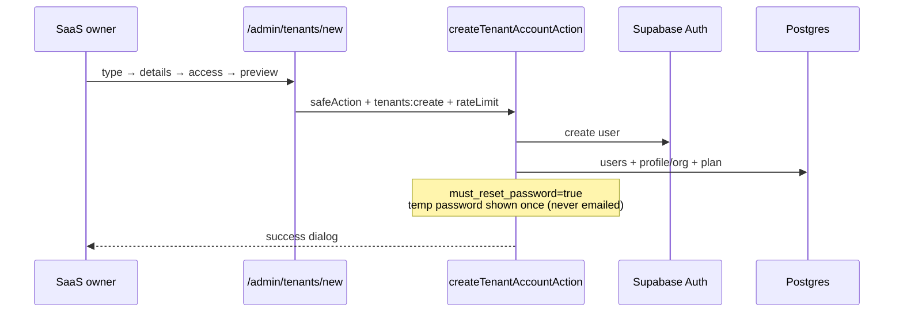
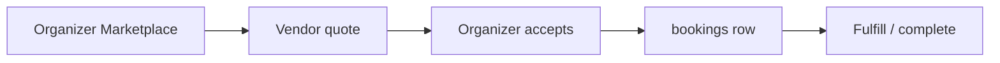
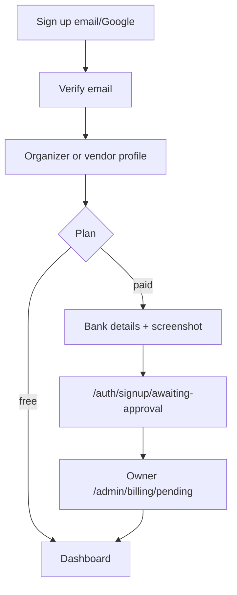
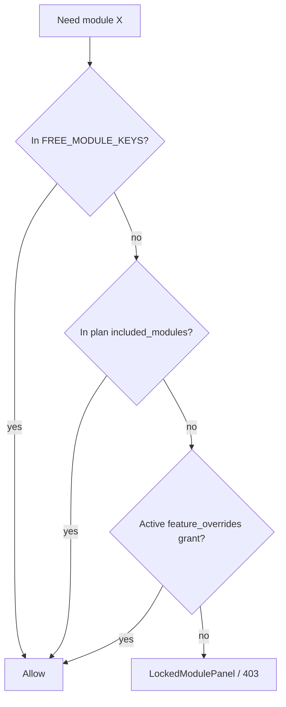
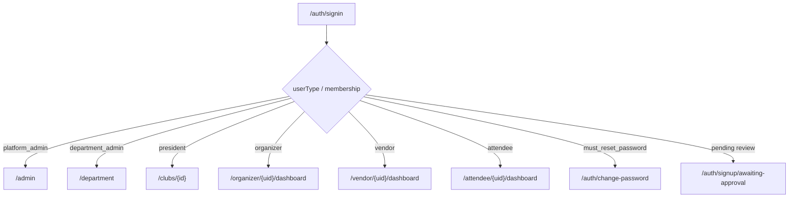
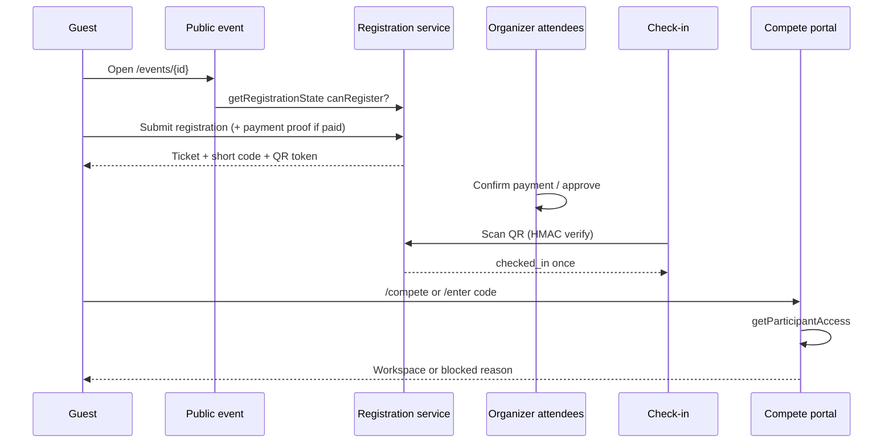
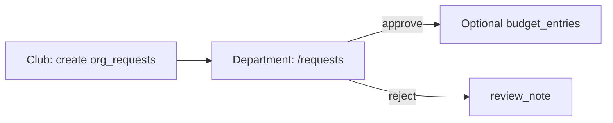
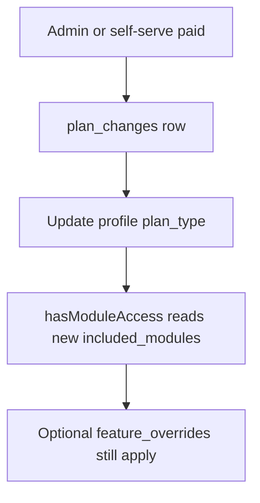

# Avoeline — Product & Operations Guide

**Audience:** any human or AI that needs full product knowledge after one read.  
**Live:** https://avoeline-website.vercel.app/  
**Canonical code map:** [`completeContext.md`](../completeContext.md)  
**Deep role specs:** [`docs/00-INDEX.md`](00-INDEX.md)  
**Security rules:** [`docs/ENGINEERING_RULES.md`](ENGINEERING_RULES.md) · [`docs/15-security-baseline.md`](15-security-baseline.md)  
**Hands-on walkthrough:** [`docs/TESTING.md`](TESTING.md)

This guide explains **who can do what**, **every tab**, **critical checks before each flow**, **plans/tenants**, **security**, and **how to run** the platform.

---

## 0. How to use this document

| If you need… | Read section |
| --- | --- |
| Stack + folder layout | §1 |
| Who is who (roles) | §2 |
| SaaS owner admin tabs | §3 |
| Department portal | §4 |
| Club president portal | §5 |
| Organizer rail + event tabs | §6 |
| Vendor portal | §7 |
| Attendee / public / compete | §8 |
| Plans, modules, overrides | §9 |
| Security model | §10 |
| Pre-flight checks (QR, check-in, dates…) | §11 |
| End-to-end flows (diagrams) | §12 |
| Local setup & testing | §13 |
| File pointers for agents | §14 |

**Rule for agents:** after reading this guide, open only the files named in §14 / `completeContext.md` for the feature you are changing. Do not scan the whole tree first.

---

## 1. Tech stack & architecture

### 1.1 Stack

| Layer | Choice |
| --- | --- |
| Framework | **Next.js 16** App Router, **React 19**, TypeScript |
| Styling | Tailwind **4** |
| Auth | **Supabase Auth** (cookies via `@supabase/ssr`) |
| Database | **Supabase Postgres** (typed client, RLS) |
| Storage | Supabase Storage (`media` public; `certificates`, receipts private) |
| Hosting | Vercel |
| Email | Resend / platform outbox (`email_outbox` + cron) |
| Charts / PDF / QR | `recharts`, `pdf-lib`, `exceljs`, `qrcode`, Konva cert editor |

**Firebase / Firestore are gone.** Never reintroduce `adminDb` or Firestore APIs. All reads/writes go through `supabaseAdmin` or `createSupabaseServer()` from `data/supabase.ts`.

### 1.2 Layer diagram



### 1.3 Code layout

| Layer | Path | Role |
| --- | --- | --- |
| Routes (thin) | `src/app/**` | Compose + fetch; prefer Server Actions |
| Features | `src/features/<name>/` | `types`, `*.service.ts`, `actions/*.action.ts`, `components/` |
| Data | `data/` | `TABLES`, `supabaseAdmin`, SSR client |
| Env | `src/env.ts` | Zod-validated public/server env |
| Edge gate | `src/proxy.ts` | Session cookie + role URL prefixes |

Path alias: `@/*` → repo root.

---

## 2. Roles & tenancy model

### 2.1 Identity types

| Session `userType` | Fine `User.role` / membership | Home after login |
| --- | --- | --- |
| `admin` | `platform_admin` (+ optional `is_owner`) | `/admin` |
| (derived) | `department_admin` via `org_memberships` | `/department` |
| (derived) | club `president` / executive | `/clubs/{clubId}` |
| `organizer` | `organizer` / `team_lead` | `/organizer/{userId}/dashboard` |
| `vendor` | vendor profile | `/vendor/{userId}/dashboard` |
| `attendee` | `attendee` | `/attendee/{userId}/dashboard` |

Department and club roles are **not** stored as primary `users.role` alone — `withOrgStanding` derives them from `org_memberships`.

### 2.2 Hierarchy



### 2.3 Auth gates (every write)

Order enforced on server actions (ENGINEERING_RULES **S2**):

1. Session (`getAuthenticatedUser` / `requireRole`)
2. Ownership / org scope (`assertOwnedEvent`, `canManageOrg`, `canLeadClub`)
3. Plan module (`hasModuleAccess` / `hasVendorModuleAccess`)
4. Permission (`can(user, permission, scope)` / staff tab grants)
5. Zod input validation

UI mirrors locks with `LockedModulePanel`; **never trust UI alone**.

**S9:** No “Enter view” impersonation. Platform staff use `/admin/...` detail pages only.

---

## 3. SaaS owner (platform admin)

**Base:** `/admin` · Layout: `src/app/admin/layout.tsx` · Areas: `orgs | organizers | events | vendors | support | categories | tenants | plans | website`

Owners (`is_owner`) get all areas + Platform staff. Staff get only granted areas + caps.

### 3.1 Rail tabs

| Tab | Path | Purpose |
| --- | --- | --- |
| Dashboard | `/admin` | Platform alerts, high-level health |
| Departments & clubs | `/admin/orgs` (+ `/admin/departments`, `/admin/clubs`) | Verify orgs, open detail (not product impersonation) |
| Organizers | `/admin/organizers` | Review profiles, suspend, plan context |
| Events | `/admin/events` | Moderation / featured / reports |
| Vendors | `/admin/vendors` | Approve / suspend vendor profiles |
| Support | `/admin/support` | Support tickets / moderation logs |
| Categories | `/admin/categories` | Super categories + event formats (seed if empty) |
| Tenant accounts | `/admin/tenants` | Create/manage department, organizer, vendor tenants |
| Plans | `/admin/plans` | Subscription plans, modules, pricing, public flags |
| Website | `/admin/website` | Marketing CMS, legal, contact, partners |
| Billing pending | `/admin/billing/pending` | Approve paid-plan bank proof |
| Bank details | `/admin/settings/billing` | Platform bank / JazzCash / EasyPaisa shown at checkout |
| Platform staff | `/admin/admins` | Owners only — grant areas + tenant/website caps |

### 3.2 Tenant create flow



**Checks before create**

- Cap: `canTenantCap('tenants:create')` + `holdsArea('tenants')`
- Rate limit on create action
- Auth user rolled back if domain writes fail
- Password never logged / never emailed (S11)

### 3.3 Plans & overrides (owner)

- Plans live in `subscription_plans` (`key`, price, `included_modules`, audience, caps).
- Changing a tenant plan writes `plan_changes` and updates `organizer_profiles.plan_type` (or vendor equivalent).
- **Bonus unlock:** `feature_overrides` (grant/deny per module, optional expiry) — above plan, not tied to price.
- **Custom pricing:** `custom_pricing_agreements` — billing notes only; does not gate modules.
- Paid self-serve wait at `/auth/signup/awaiting-approval` until `/admin/billing/pending` approval.

### 3.4 Website CMS caps

`website:view | website:edit | website:publish | legal:publish | contact:manage | community:view` via `canWebsiteCap`.

---

## 4. Department admin

**Base:** `/department` · Chrome from `departmentChrome()` · Role: `department_admin` via `org_memberships`.

### 4.1 Tabs

| Tab | Path | Purpose |
| --- | --- | --- |
| Dashboard | `/department` | Overview of clubs / pending items |
| Events | `/department/events` | Events under child clubs / dept scope |
| Analytics | `/department/analytics` | Filter by club, tenure, category, date |
| Marketplace | `/department/marketplace` | Vendor marketplace (if module on) |
| Clubs | `/department/clubs` | Create/list clubs, module access toggles |
| Tenures | `/department/tenures` | Academic year / committee terms (`org_tenures`) |
| Announcements | `/department/announcements` | Push to clubs (`org_announcements`) |
| Requests | `/department/requests` | Approve/reject club `org_requests` (budget, event, other) |
| Connections | `/department/settings/connections` | Google email/calendar/Drive/Sheets |

### 4.2 Department → club controls

- Scope: child orgs where `parent_org_id = department`.
- Toggle club modules via `org_module_access` (budget, teams, sponsors, certificates, etc.).
- Club presidents only see modules enabled here **and** matching plan/override rules where applicable.
- Platform staff **must not** use department chrome (S9) — redirected to `/admin/departments/[id]`.

### 4.3 Pre-use checks

- User has live membership (`accountIsLive`); suspended → `/suspended`.
- Analytics/exports stay scoped to managed org IDs (`managedOrgIds`).
- Budget request approval optionally creates `budget_entries` income — confirm amount server-side.

---

## 5. Club president

**Base:** `/clubs/{clubId}` · Chrome from `clubChrome()` · Must pass `isClubPresident`.

### 5.1 Tabs (module-gated)

| Tab | Path | Gate |
| --- | --- | --- |
| Dashboard | `/clubs/{id}` | always |
| Events | `/clubs/{id}/events` | `events_dashboard` |
| Analytics | `/clubs/{id}/analytics` | `analytics_basic` |
| Marketplace | `/clubs/{id}/marketplace` | `vendor_store` |
| Designer | `/clubs/{id}/designer` | `ai_designer` |
| Ushers | `/clubs/{id}/ushers` | `ushers_ops` |
| Teams | `/clubs/{id}/teams` | teams modules |
| Requests | `/clubs/{id}/requests` | always — upward to department |

### 5.2 Club flows

- **Committee teams** scoped to current `org_tenures` (`is_current`).
- **Event ops** reuse organizer event UI scoped by `org_id`.
- **Requests:** create `org_requests` (`budget` | `event_approval` | `other`) → department queue.
- Profile/notifications often deep-link to organizer paths for the same user.

### 5.3 Checks

- Non-presidents do not get chrome (layout returns children only / access denied paths).
- Module tabs omitted when `has()` / `org_module_access` false — still enforce on server for direct URLs.

---

## 6. Organizer

**Base:** `/organizer/{organizer_id}` · Layout gates modules into the rail.

### 6.1 Organizer rail

| Tab | Path | Module |
| --- | --- | --- |
| Dashboard | `.../dashboard` | always |
| Events | `.../events` | `events_dashboard` |
| Analytics | `.../analytics` | `analytics_basic` |
| Marketplace | `.../vendor-marketplace` | `vendor_store` |
| Designer | `.../designer` | `ai_designer` |
| Ushers | `.../ushers` | `ushers_ops` |
| Teams | `.../teams` | `teams_basic` / advanced |
| Forms | `.../forms` | custom forms library |
| Connections | `.../settings/connections` | Google integrations |
| Quotes | `.../quotes` | vendor_store related |

Locked modules show `LockedModulePanel` instead of silent 404 when possible.

### 6.2 Event workspace tabs

Path: `/organizer/{id}/events/{eventId}/…`

| Tab | Purpose |
| --- | --- |
| Overview | Schedule, publish state, checklist, capacity snapshot |
| Attendees | Registrations, payments, check-in, emails, import (Connections) |
| Team / Staff | Assign library teams + members to this event |
| Access | Visibility, invite links, whitelist, ticket tiers & promos (non-hackathon) |
| Agenda | Sessions |
| Speakers | Speaker roster + agenda links |
| Vendors | Marketplace bookings + external vendors (if `vendor_store`) |
| Sponsors | Sponsors/partners |
| Expenses | Spend/credits + receipts |
| **Competitions** | Hackathon tracks (if hackathon format + `hackathon_ops`) |
| **Phases & Tasks** | Phases, tasks, CTF flags (hashed) |
| **Submissions** | Team submissions review |
| **Scoreboard** | Live scores |
| **Settings** | Hackathon/compete settings matrix |
| Certificates | Templates, issue, jobs (if `certificates`) |
| Files | Linked Drive files |
| Exports | Excel / Sheets sync |

Staff with `event_staff_assignments` may use owner event URLs for granted tabs only (`assertEventActor`).

### 6.3 Event creation (wizard)

High level: category/format → details → schedule → access/pricing → review → publish.  
Hackathon formats drive competitions UI; paid non-hackathon uses ticket tiers.  
Registration window math is centralized in `getRegistrationState` (`docs/24-registration-state.md`).

### 6.4 Organizer module keys (source of truth)

**Free:** `events_dashboard`, `ai_planner`, `analytics_basic`, `registrations`, `access_control`, `sponsors_basic`, `teams_basic`  
**Paid:** `teams_advanced_roles`, `vendor_store`, `certificates`, `api_access`, `website_builder`, `ai_designer`, `ushers_ops`, `hackathon_ops`, `sponsors_invoicing_templates`

Resolution: free key **or** plan `included_modules` **or** active `feature_overrides` → `hasModuleAccess`.

---

## 7. Vendor

**Base:** `/vendor/{vendor_id}`

| Tab | Path | Module |
| --- | --- | --- |
| Dashboard | `.../dashboard` | `vendor_dashboard` |
| Quotes | `.../quotes` | `vendor_quotes` |
| Services | `.../services` | `vendor_services` (free max **5** services) |
| Bookings | `.../bookings` | `vendor_bookings` |
| Connections | `.../settings/connections` | Google |

**Paid vendor modules:** `vendor_portfolio`, `vendor_event_marketing`, `vendor_analytics`.  
Portfolio videos require `vendor_portfolio`. Plans: e.g. `vendor_free` / `vendor_pro` editable in `/admin/plans`.

### 7.1 Quote → booking



**Checks:** IDOR gates on vendor_store (T9) — vendor may only mutate own quotes/bookings; organizer only own events; plan must include `vendor_store` for organizer side.

Self-serve vendors stay `pending` until admin `setVendorStatus` / billing approval for paid plans.

---

## 8. Attendee, public site, hackathon compete

### 8.1 Public

- Marketing CMS: `/`, about, partners, contact, public plans.
- Event discovery: `/events`, public event page `/events/{eventId}`.
- Register / waitlist / ticket / status via unguessable tokens (S12).
- Apply / invite / collaborate / judge links are tokenized — not session-only.

### 8.2 Attendee shell

`/attendee/{userId}/dashboard` — “My events”, browse `/events`. Non-attendee sessions redirected to their own dashboard.

### 8.3 Registration & ticket

Statuses (simplified): `pending` → `awaiting_payment` → `confirmed` / `waitlisted` / `rejected` / `cancelled` → `checked_in` / `attended` / `no_show`.

Display: short code `AVO-…`. Door QR = **HMAC-signed opaque check-in token** (no PII in QR JSON). Ticket capability URL uses registration UUID.

Env: `REGISTRATION_QR_SECRET` (≥16 chars) — **required**; never fall back to service-role key.

### 8.4 Check-in (door)

- Staff lookup: signed QR token or short code (`lookupCheckIn.action`).
- Update sets `checked_in = true` only if currently `false` (concurrent double-tap safe → idempotent success).
- Re-scanning an already checked-in ticket does **not** create a second check-in row; status stays checked in.

### 8.5 Hackathon participant portal (`/events/{eventId}/compete`)

Entry gated by `getParticipantAccess` (`src/features/hackathon/participantAccess.ts`).

| Reason code | Meaning | What to do |
| --- | --- | --- |
| `not_logged_in` | No registration session / team code | Enter emailed team access code |
| `registration_not_found` | Bad registration | Re-register / ask organizer |
| `payment_pending` / `payment_rejected` | Pay not OK | Upload proof / contact organizer |
| `awaiting_approval` | Pending / rejected / cancelled / no_show | Wait or contact |
| `waitlisted` | Waitlist | Wait for promotion |
| `not_checked_in` | `requireCheckIn` and status not checked_in/attended | On-site check-in first |
| `roster_not_locked` | Roster still open (when enforced) | Wait for lock |
| `competition_not_open` / `competition_closed` | Outside track window | Wait / contact |
| `ok` | Allowed | Compete workspace |

**Typical “ready to compete” checklist**

1. Registration **confirmed** (or checked_in/attended).
2. Payment **accepted** (not pending/failed/refunded).
3. **Checked in** when the event requires door check-in.
4. Team exists; track not ended; within `opensAt`/`closesAt` when set.
5. Access via hashed `access_code` or roster join code at `/enter` — codes hashed at rest (S7); failures audited (`compete_access_failures`).

CTF flags: store HMAC, timing-safe compare, throttle (S8). Never send `flag_hash` to the client.

---

## 9. Payment plans, tenants, modules

### 9.1 Self-serve funnel



Admin-created tenants skip wait and get plan immediately; forced password reset on first login.

### 9.2 Gating resolution



Vendor path uses `VENDOR_*` keys + `hasVendorModuleAccess`. Club tabs also respect `org_module_access`.

### 9.3 Email caps

Plan daily/monthly caps (`plan_email_limits` / overrides). Bulk sends via outbox + cron. Suppressions respected. See `docs/18-email-send-limits-and-scheduling.md`.

---

## 10. Security model (summary)

| ID | Rule | Practice in product |
| --- | --- | --- |
| S1 | Secrets server-only | Service role, Resend, `REGISTRATION_QR_SECRET` never `NEXT_PUBLIC_` |
| S2 | Authz every entry | Session → ownership → module → `can` → zod |
| S3 | RLS + private storage | Signed URLs ≤5m for proofs/receipts |
| S4 | Validation | zod allowlists; no mass assignment |
| S5 | Uploads | Size/MIME/random keys; attachment disposition |
| S6 | Rate limits | Login, register, promo, access code, flags, invites, support, bulk email, apply |
| S7 | Tokens | ≥128-bit invites; hashed access codes + lockout |
| S8 | CTF | HMAC flags, throttle, no early hints |
| S9 | No impersonation | Admin detail pages only |
| S10 | Audit | Privileged admin/staff actions logged |
| S11 | Passwords | Never email passwords; force reset |
| S12 | Public pages | Unguessable ticket URLs; minimal DTOs |
| S13 | XSS/SQL | Escape email HTML; parameterized SQL |
| S14 | Headers | CSP enforced + HSTS in `next.config.ts` |
| S15 | URL safety | Same-origin redirects; host allowlists |
| S16–S19 | Deps / errors / MFA / leak scan | Lockfile, generic client errors, owner MFA, gitleaks |

**Proxy** (`src/proxy.ts`): protects `/organizer`, `/vendor`, `/attendee`, `/admin`, `/department`, `/clubs`. Token public routes rely on page/action checks.

**Data access rule:** never import `supabaseAdmin` in `"use client"` files.

---

## 11. Pre-flight checks & invariants (ops cheat sheet)

Use this before demo day or release smoke.

### 11.1 Door / QR

- [ ] `REGISTRATION_QR_SECRET` set (≥16) in every environment.
- [ ] QR encodes opaque signed token — not email/name JSON.
- [ ] First successful scan sets `checked_in`; second scan is **idempotent** (no duplicate check-in).
- [ ] Staff only check in for events they may act on (`assertEventActor` / ownership).

### 11.2 Registration window

- [ ] Server uses `getRegistrationState` with server `now` (not client clock alone).
- [ ] Closed / full / unpublished / ended refuse `createPublicRegistration`.
- [ ] Promo redeem via RPC `redeem_promo` (atomic usage).

### 11.3 Hackathon compete

- [ ] Participant: confirmed + payment OK + check-in if required + track open.
- [ ] Team access code hashed; lockout on failures.
- [ ] Tasks only for open phases; flags verified server-side.
- [ ] Organizer has `hackathon_ops` (or override); format is hackathon.

### 11.4 Plans / isolation (T9)

- [ ] Locked module URLs show lock panel / deny — no data leak across tenants.
- [ ] Vendor cannot read another vendor’s quotes; organizer cannot book without `vendor_store`.
- [ ] Feature overrides expire correctly when `expires_at` set.

### 11.5 Tenants / admin

- [ ] Staff caps respected (`tenants:create`, `plans:change`, …).
- [ ] Suspended users hit `/suspended`.
- [ ] Pending organizers/vendors cannot enter product dashboards.

### 11.6 Connections / email

- [ ] OAuth secrets only in `integration_secrets` (service role).
- [ ] Email daily/monthly caps not exceeded; suppressions honored.
- [ ] Cron drains `email_outbox` with idempotency keys.

### 11.7 Certificates

- [ ] PDFs rendered on demand — not stored permanently.
- [ ] Private bucket assets via short signed URLs.
- [ ] Module `certificates` required to issue.

---

## 12. Major flows (graphs)

### 12.1 Role landing



### 12.2 Public register → ticket → check-in → compete



### 12.3 Department request loop



### 12.4 Plan change



---

## 13. How to run, seed, and test

### 13.1 Local

```bash
# Install + env
cp .env.example .env.local   # fill Supabase, secrets, SAAS_OWNER_*, REGISTRATION_QR_SECRET
npm install
npm run setup:buckets        # Storage buckets if needed
npm run seed:owners          # platform owners from SAAS_OWNER_EMAILS
npm run seed:demo            # optional *@avoeline.demo (password AvoelineDemo1!)
npm run dev                  # http://localhost:3000
```

Admin sign-in: `/admin/signin`. Seed categories on `/admin/categories` if empty.

**Full wipe (destructive):** `CONFIRM=YES npm run reset:wipe-data` then `seed:owners` again.

### 13.2 Quality commands

| Command | Purpose |
| --- | --- |
| `npm run typecheck` / `lint` / `knip` | Static gates |
| `npm run test:unit` | Vitest |
| `npm run test:e2e` | Playwright |
| `npm run test:load:reads` | k6-style reads (when configured) |
| `npm run test:api-smoke` | API smoke |
| `npm run types:db` | Regenerate DB types after migrations |

Walkthrough by role: [`docs/TESTING.md`](TESTING.md). Program: [`docs/25-testing-and-load-program.md`](25-testing-and-load-program.md).

### 13.3 Release readiness

CI: PR + merge + nightly + prod-smoke (soft-skip when tools/secrets missing).  
Release checklist may still be **NO-GO** until load/email/Lighthouse gates are green — see `plans/` release-readiness notes and `completeContext` changelog.

---

## 14. Where to look in code (agent map)

| Concern | Open first |
| --- | --- |
| Living map | `completeContext.md` |
| Module keys | `src/features/permissions/moduleKeys.ts` |
| Module access | `src/features/permissions/` (`hasModuleAccess`, overrides) |
| Auth / RBAC | `src/features/auth/`, `src/proxy.ts` |
| Admin areas/caps | `src/features/admin/types.ts`, `src/app/admin/layout.tsx` |
| Department chrome | `src/features/department/department.service.ts` |
| Club chrome | `src/features/clubs/club.service.ts` |
| Organizer rail | `src/app/organizer/layout.tsx` |
| Event tabs | `src/app/organizer/[organizer_id]/events/[eventId]/layout.tsx` |
| Vendor rail | `src/app/vendor/layout.tsx` |
| Registration / QR | `src/features/registration/`, `qr.ts`, check-in actions |
| Compete gate | `src/features/hackathon/participantAccess.ts` |
| Registration window | `src/lib/registrationState.ts` |
| Tables | `data/collections.ts` |
| Schema | `supabase/migrations/` |
| Plans archive | `plans/INDEX.md` |

Role depth docs: `docs/01`–`07`, `12`, `15`–`20`, `24`. Architecture: `docs/ARCHITECTURE.md`.

---

## 15. Feature coverage snapshot

| Area | Free / Paid | Notes |
| --- | --- | --- |
| Events CRUD | Free `events_dashboard` | Core |
| Registrations / promos | Free `registrations` | State machine + QR |
| Access / invites | Free `access_control` | |
| Teams basic | Free | Advanced roles paid |
| Analytics | Free `analytics_basic` | |
| Sponsors basic | Free | Invoicing templates paid |
| Vendor marketplace | Paid `vendor_store` | Vendor free quote/services/bookings |
| Hackathon ops + compete | Paid `hackathon_ops` | Participant gates §8.5 |
| Certificates | Paid | On-demand PDF |
| Ushers / Designer | Paid | |
| Forms library | Free (until priced) | `/forms`, `/f/[token]` |
| Connections Google | Cap by email plan | docs/17 |
| Marketing CMS | Website caps | docs/19 |
| Dept / club / tenures | Org membership | docs/02–03 |
| SaaS tenants / plans | Owner/staff | docs/01 |

---

## 16. Sharing this guide

Upload or paste **this file** plus, if the consumer will edit code:

1. `completeContext.md`
2. `docs/ENGINEERING_RULES.md`
3. Optional: role doc for the area being changed (`01`–`07`)

That set is enough for another AI or teammate to understand **product flows, tabs, checks, security, plans, and stack** without rediscovering the repo.
