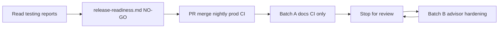

# T10 — Release readiness, CI, fix batches

**Contract:** [`docs/25-testing-and-load-program.md`](docs/25-testing-and-load-program.md) T10; evidence from [`docs/testing/load-report.md`](docs/testing/load-report.md), [`security-report.md`](docs/testing/security-report.md), [`ui-sweep-report.md`](docs/testing/ui-sweep-report.md), [`plan-isolation-report.md`](docs/testing/plan-isolation-report.md), [`test-matrix.md`](docs/testing/test-matrix.md), [`README.md`](docs/testing/README.md).  
**Outputs:** [`docs/testing/release-readiness.md`](docs/testing/release-readiness.md); CI workflows; archive `plans/2026-11-15-t10-release-readiness.md` + [`completeContext.md`](completeContext.md) changelog.

## Locked verdict (from reports — write as-is)

| Area | Status | Basis |
| --- | --- | --- |
| Unit | **pass** | `npm run test:unit` + security/permission unit suites |
| Integration | **partial** | status CHECK tests + optional marketing RLS; no full DB integration gate in CI today |
| API | **pass (local)** | Postman Negative Newman 20/20; `test:api-smoke` exists |
| E2E | **pass (scoped)** | smoke + T8 + T9 local; dept/club/vendor auth projects skipped |
| Email | **fail / not executed** | Guards + snapshots exist; no T5 `live-smoke.md` / allowlisted inbox report |
| Google | **partial** | MSW mock unit smoke; live session manual (`auth:google`); T5 not run |
| Load | **fail / not executed** | k6 missing; capacity **unknown** ([load-report.md](docs/testing/load-report.md)) |
| Security | **pass with debt** | Critical/high T7 items fixed; open mediums SEC-005/006/008 |
| UI sweep | **pass** | Double-tap inventory + pending/idempotency |
| Accessibility | **pass (scoped)** | Guest axe pass after UI-008/010; not full product surface |
| Plan isolation (T9) | **pass** | Highs fixed; Playwright 4/4 |

**Go / no-go:** **NO-GO** until checklist items below are true. Do not claim go while load is unmeasured or live email/Google/Lighthouse are absent.

### Go checklist (must all be true)

- No open **critical** or **high** defects (T7/T8/T9 highs closed; toolchain npm highs stay **medium / accepted** unless proven runtime)
- Load targets met (docs/25 A5) — currently **not met** (`executed: false`)
- Zero double-submit failures on wired surfaces — **met** for inventory/probes; expand remaining surfaces later
- Email checks passed (T5 allowlisted) — **not met**
- Lighthouse + a11y targets met — a11y scoped **pass**; marketing Lighthouse checklist **not filled** this program

### Open defects (carry into readiness doc)

| ID | Sev | Source | Note |
| --- | --- | --- | --- |
| SEC-005 | medium | security | Remaining npm audit highs (puppeteer/lighthouse chain) — not prod runtime |
| SEC-006 | medium | security | Advisors WARN: search_path mutable, citext public, leaked-password protection off |
| SEC-008 | info | security | osv/gitleaks/ZAP tools missing |
| LOAD-001 | high* | load | *Gate blocker: load never executed — treat as release blocker, not a code CVE |
| EMAIL-001 | high* | T5 gap | Live allowlisted email report missing |
| GH-001 | medium | Google | Live T5 not run |
| T9 soft | low | plan-isolation | SSR cookie harness; dept/club Playwright |

### Measured capacity / known limits

- **Measured capacity:** unknown (k6 not run).
- **Known limits:** heavy load local-only; never prod/Vercel without notice; `MAX_REAL_EMAILS_PER_RUN=30`; Google Testing mode ~7-day consent; ZAP/osv/gitleaks optional when tools absent (honest `executed: false`).

---

## 1. Write `docs/testing/release-readiness.md`

Single source of truth: area table, open defects, capacity/limits, go checklist (all failed items explicit), links to the four reports + matrix, “how to flip to GO” steps (`install k6` → `test:load:reads`; staging T5; `report:marketing`).

Update [`docs/testing/README.md`](docs/testing/README.md) with a T10 section pointing at it.

---

## 2. CI setup (concrete workflows)

Extend / add under [`.github/workflows/`](.github/workflows/):

### PR — unit + integration + Postman ([`ci.yml`](.github/workflows/ci.yml))

Keep existing typecheck / unit / knip / build.

Add after build (same job or sibling):

1. **Integration:** keep statusConstraints; run `npm run test:sql:marketing` only when `SUPABASE_DB_URL` set (already patterned).
2. **Postman:** start `next start` in background with existing CI placeholder Supabase env + `APP_ENV=local` + `BASE_URL=http://127.0.0.1:3000`; wait for `/events` or health; run `npm run test:security:postman` (and optionally `test:security:authz`). Soft-skip with exit 0 only if server never becomes ready (same honesty as local harnesses) — prefer hard fail if build succeeded but server died.

### Merge (push `main`/`master`) — E2E smoke

New job `e2e-smoke` on push to main (not required on every PR to keep PR fast):

- `npm ci` → `npx playwright install chrome` → build → `next start` → `npx playwright test e2e/smoke.spec.ts --project=chromium` (or a dedicated `e2e-smoke` project matching smoke only).
- Uses placeholder env; public routes only (matches current smoke).

### Nightly — security baseline + k6 smoke

New [`nightly-local.yml`](.github/workflows/nightly-local.yml) (`schedule: cron` + `workflow_dispatch`):

- Install **k6** (official binary/apt).
- `npm run test:security:unit`, `test:security:deps` (osv/gitleaks soft-skip if missing).
- Build + start app; `test:security:transport` + `test:security:authz` + `test:security:postman`.
- `test:security:zap` soft-skip without Docker.
- k6: if secrets `EVENT_ID` + allowlisted `BASE_URL` present, `npm run test:load:reads`; else write `reports/load/status.json` `executed: false` and **fail the job only when secrets were expected** — default: soft-skip with summary annotation so nightly stays green until secrets are configured.

### After deploy — read-only production smoke

New [`prod-smoke.yml`](.github/workflows/prod-smoke.yml):

- `workflow_dispatch` + optional `repository_dispatch` / cron.
- Run `node scripts/smoke-api-routes.mjs` against `PRODUCTION_SMOKE_URL` (default `https://avoeline-website.vercel.app`) — already read-only GETs / unauth expectations; **do not** send CRON_SECRET in CI unless a dedicated smoke secret exists (keep unauthorized cron → 401 checks only).
- Refuse mutating probes; never wipe/seed prod.

Package scripts (thin wrappers): `test:ci:postman`, `test:e2e:smoke`, `test:prod-smoke`.

---

## 3. Fix remaining defects in batches (stop between batches)

**Batch A — docs + CI only (this session first deliverable)**  
Write readiness + workflows + README/matrix pointers + plans archive. No product behavior change. **Stop** for review.

**Batch B — SEC-006 search_path (smallest safe DB hardening)**  
Migration: `SET search_path = public` (or empty) on remaining mutable DEFINER functions called out by advisors (same pattern as prior T7 revoke migration). Re-check via Supabase `get_advisors` / document in security-report appendix. **Stop**.

**Batch C — only if Batch B accepted**  
Do **not** chase puppeteer/lighthouse audit highs (SEC-005 accepted). Optionally add a one-line `engines`/docs note that `report:marketing` is tooling-only. No large dep tree surgery.

Out of scope for automated T10 code (remain NO-GO blockers until separately run): install k6 locally and execute load group 1; author T5 `live-smoke.md`; fill marketing Lighthouse checklist.

---

## 4. Docs hygiene

- Archive plan → [`plans/2026-11-15-t10-release-readiness.md`](plans/2026-11-15-t10-release-readiness.md) + [`plans/INDEX.md`](plans/INDEX.md).
- Changelog line in [`completeContext.md`](completeContext.md).

## Preconditions

- Local evidence already captured in reports; CI changes do not require re-running full T6–T9 locally in Batch A.
- Batch B needs Supabase migration apply (local CLI or MCP) before claiming advisor WARN cleared.