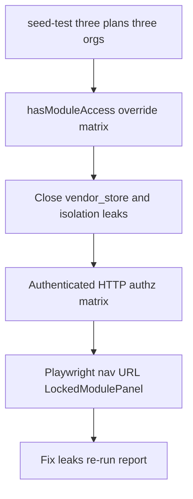

# T9 — Plan gating and tenant isolation

**Contract:** [`docs/ENGINEERING_RULES.md`](docs/ENGINEERING_RULES.md) S2/S9, [`docs/04-organizer.md`](docs/04-organizer.md) module keys + `hasModuleAccess`, [`docs/25-testing-and-load-program.md`](docs/25-testing-and-load-program.md) T9 + A4.  
**Targets:** Local only (`APP_ENV=local`); refuse production / `avoeline.aroxes.com` via existing test guards.  
**Output:** [`docs/testing/plan-isolation-report.md`](docs/testing/plan-isolation-report.md); rows in [`docs/testing/test-matrix.md`](docs/testing/test-matrix.md); archive `plans/2026-11-15-t9-plan-isolation.md` + [`completeContext.md`](completeContext.md).

## Locked product semantics

- **Module keys (docs/04):** `vendor_store`, `ushers_ops`, `ai_designer` (and other paid keys as needed for “partial”). Free keys stay ungated (`ai_planner` ≠ `ai_designer`).
- **Nav:** top-level organizer rail **hides** locked Marketplace / Designer / Ushers (matches current [`organizer/layout.tsx`](src/app/organizer/layout.tsx) + A4).
- **Direct URL:** `LockedModulePanel` (200 + upsell) for page routes — acceptable under T9 “upsell or 403”.
- **Mutating entry points:** server actions / APIs must refuse with `MODULE` / `FORBIDDEN` (assert as non-success; treat as 403-equivalent in the matrix).
- **Downgrade:** data retained; `hasModuleAccess` false → UI locked + mutations blocked.

## 1. Deterministic seed (`seed:test`)

Restore [`scripts/seed-test.mjs`](scripts/seed-test.mjs) + [`scripts/cleanup-test.mjs`](scripts/cleanup-test.mjs) (referenced in `package.json` / docs but missing).

Create (idempotent, `is_test` where columns exist):

| Plan key | Name | `included_modules` |
| --- | --- | --- |
| `social_lite` | Social Lite | all free keys only — **no** `vendor_store`, `ushers_ops`, `ai_designer` |
| `partial_ops` | Partial Ops | free + e.g. `certificates`, `hackathon_ops`, `teams_advanced_roles` — still no Vendor/Ushers/Designer |
| `full` | Full | union of organizer paid keys from [`moduleKeys.ts`](src/features/permissions/moduleKeys.ts) |

Three organizers (fixed emails/UUIDs documented in seed output): `org.social@avoeline.test`, `org.partial@avoeline.test`, `org.full@avoeline.test`, password from `DEMO_SEED_PASSWORD` / `SEED_TEST_PASSWORD`. Also two organizers A/B with events (or reuse demo) and two vendors for isolation rows. Wire `npm run seed:test` / `cleanup:test` to existing safety helpers ([`scripts/lib/testSafety.mjs`](scripts/lib/testSafety.mjs)).

Admin plan creation is covered by seed + one Vitest/service assertion that `savePlan`-shaped module lists match keys (optional thin Playwright admin smoke if owners seed available).

## 2. Unit matrix — overrides + plan resolution

Extend Vitest under `src/features/permissions/__tests__/`:

- Extract pure helper if needed (e.g. `resolveModuleAccessFromRows`) mirroring deny → grant → org override → club `org_module_access` → plan `included_modules` / inactive plan from [`permissions.service.ts`](src/features/permissions/permissions.service.ts).
- Cases: Social Lite denies trio; Full allows; Partial allows only listed; grant unlocks Social Lite; deny beats grant; expired grant denied ([`overrideLive`](src/features/permissions/overrideLive.logic.ts)); plan change interaction (plan includes module + deny override → denied).
- Keep existing [`tests/security/__tests__/overrideLive.test.ts`](tests/security/__tests__/overrideLive.test.ts).

## 3. Close gating / isolation leaks (before claiming pass)

| Gap | Fix |
| --- | --- |
| Event **Vendors** tab / booking writes ignore `vendor_store` | Gate event layout tab + `src/features/bookings/**` / `event_vendors` mutations with `hasModuleAccess(organizerId, "vendor_store")`; page shows `LockedModulePanel` |
| Vendor booking detail IDOR | In [`vendor/.../bookings/[booking_id]/page.tsx`](src/app/vendor/[vendor_id]/bookings/[booking_id]/page.tsx) (and sibling mutate actions): require session vendor owns booking; else notFound/403 |
| Designer / Ushers | Keep page `LockedModulePanel`; if no mutating APIs exist, matrix marks API row `N/A` with evidence — do not invent endpoints |
| Certificates / hackathon / teams | Confirm existing `MODULE` fails; add regression tests |

## 4. Authenticated HTTP / Playwright matrix

New harness [`tests/security/authz-tenant.mjs`](tests/security/authz-tenant.mjs) (or `tests/plan-gating/`) + Playwright `e2e/t9/`:

**Plan gating (per Social Lite / Partial / Full organizer):**

- Nav HTML: Marketplace / Designer / Ushers links absent when locked, present when unlocked.
- Direct URLs: `/organizer/{id}/vendor-marketplace|designer|ushers` → LockedModulePanel copy (or redirect for clubs).
- Event tabs: certificates / vendors / hackathon respect plan.
- Actions: attempt certificate issue / booking create / similar → refuse when locked.
- Public `/events/{id}` + sample email render: no locked-module CTA copy for Social Lite org events.

**Overrides:**

- Grant `certificates` to Social Lite → unlock; set `expires_at` past → locked again (service or admin action + re-read).

**Tenant isolation:**

- Organizer A cannot mutate B’s event / registrations / files (via `assertOwnedEvent` / file authorize) — expect fail.
- Dept/club: A cannot manage B’s org ([`orgScope`](src/features/department/orgScope.ts)).
- Vendor A cannot open B’s booking id.

Scripts: `test:plan-gating`, `test:e2e:t9`. Soft-skip with `executed: false` when seed missing (same honesty as T7/T8).

## 5. Report, fix loop, docs

- Write findings into `docs/testing/plan-isolation-report.md` (severity, evidence, fix, re-run).
- Update `docs/testing/README.md` + T9 rows in `test-matrix.md`.
- Fix **critical/high** leaks in-session; medium/low → T10.
- Archive plan + changelog.

## Preconditions

- Local Supabase + `npm run build && npm run start`.
- `npm run seed:test` (and `seed:owners` only if admin Playwright plan-create smoke is run).
